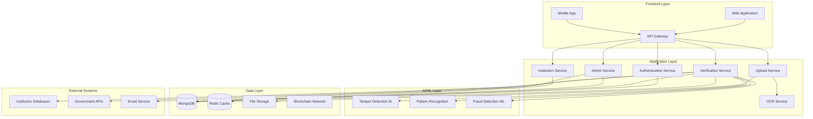

# Design Document

## Overview

The Fake Certificate Detection System is a comprehensive platform designed to authenticate academic certificates through multiple verification layers including OCR, AI-powered tamper detection, institutional database verification, and blockchain validation. The system follows a microservices architecture with clear separation of concerns, enabling scalability and maintainability across Jharkhand's higher education ecosystem.

## Architecture

### High-Level Architecture



### System Components

1. **Frontend Applications**: Web and mobile interfaces for different user types
2. **API Gateway**: Central entry point with rate limiting and authentication
3. **Microservices**: Specialized services for different functionalities
4. **AI/ML Pipeline**: Advanced detection and pattern recognition
5. **Data Storage**: Multi-tier storage for different data types
6. **External Integrations**: Connections to institutional and government systems

## Components and Interfaces

### Core Services

#### 1. Authentication Service
- **Purpose**: Handle user authentication, authorization, and role management
- **Key Functions**:
  - JWT token generation and validation
  - Role-based access control (RBAC)
  - Multi-factor authentication for admin users
  - Session management and security logging

#### 2. Upload Service
- **Purpose**: Handle certificate document uploads and preprocessing
- **Key Functions**:
  - File validation and virus scanning
  - Image preprocessing and optimization
  - Metadata extraction
  - Queue management for processing pipeline

#### 3. OCR Service
- **Purpose**: Extract text and structured data from certificate images
- **Key Functions**:
  - Text extraction using Tesseract OCR
  - Template-based data extraction
  - Confidence scoring for extracted data
  - Multi-language support for regional certificates

#### 4. Verification Service
- **Purpose**: Core verification logic and orchestration
- **Key Functions**:
  - Multi-layer verification workflow
  - Database cross-referencing
  - AI-powered tamper detection
  - Verification result compilation

#### 5. Institution Service
- **Purpose**: Manage institutional data and certificate records
- **Key Functions**:
  - Institution registration and verification
  - Bulk certificate data uploads
  - Certificate template management
  - Institutional API integrations

#### 6. Admin Service
- **Purpose**: Administrative functions and monitoring
- **Key Functions**:
  - Dashboard analytics and reporting
  - Fraud pattern detection
  - Blacklist management
  - System monitoring and alerts

### AI/ML Components

#### 1. Tamper Detection Engine
- **Technology**: YOLOv5 for object detection, CNN for image analysis
- **Functions**:
  - Seal and signature authenticity verification
  - Photo tampering detection
  - Document structure analysis
  - Anomaly detection in certificate layouts

#### 2. Pattern Recognition System
- **Technology**: Machine learning classifiers and NLP
- **Functions**:
  - Certificate number pattern validation
  - Institutional format recognition
  - Grade and marking scheme validation
  - Course and degree program verification

#### 3. Fraud Detection ML
- **Technology**: Random Forest and ensemble methods
- **Functions**:
  - Behavioral pattern analysis
  - Duplicate certificate detection
  - Suspicious activity flagging
  - Risk scoring algorithms

## Data Models

### Certificate Model
```python
class Certificate(MongoBaseModel):
    certificate_id: str
    student_name: str
    roll_number: str
    institution_id: str
    course_name: str
    degree_type: str
    graduation_date: datetime
    grades: Dict[str, Any]
    certificate_number: str
    verification_status: str  # PENDING, VERIFIED, INVALID, SUSPICIOUS
    verification_score: float
    tamper_flags: List[str]
    created_at: datetime
    updated_at: datetime
    file_hash: str
    blockchain_hash: Optional[str]
```

### Institution Model
```python
class Institution(MongoBaseModel):
    institution_id: str
    name: str
    type: str  # UNIVERSITY, COLLEGE, INSTITUTE
    accreditation_status: str
    address: Dict[str, str]
    contact_info: Dict[str, str]
    authorized_signatories: List[Dict[str, Any]]
    certificate_templates: List[str]
    api_endpoints: Optional[Dict[str, str]]
    verification_enabled: bool
    created_at: datetime
    updated_at: datetime
```

### Verification Record Model
```python
class VerificationRecord(MongoBaseModel):
    verification_id: str
    certificate_id: str
    requester_id: str
    requester_type: str  # EMPLOYER, GOVERNMENT, INSTITUTION
    verification_method: str
    result: Dict[str, Any]
    confidence_score: float
    processing_time: float
    flags_detected: List[str]
    verification_date: datetime
    ip_address: str
    user_agent: str
```

### User Model
```python
class User(MongoBaseModel):
    user_id: str
    email: str
    password_hash: str
    role: str  # ADMIN, INSTITUTION, EMPLOYER, GOVERNMENT
    organization: Optional[str]
    permissions: List[str]
    is_active: bool
    last_login: Optional[datetime]
    created_at: datetime
    updated_at: datetime
    verification_count: int
    monthly_limit: int
```

### Blacklist Model
```python
class BlacklistEntry(MongoBaseModel):
    entry_id: str
    type: str  # CERTIFICATE, PERSON, ORGANIZATION
    identifier: str
    reason: str
    evidence: List[str]
    reported_by: str
    status: str  # ACTIVE, UNDER_REVIEW, RESOLVED
    created_at: datetime
    expires_at: Optional[datetime]
```

## Error Handling

### Error Categories

1. **Validation Errors**: Invalid input data, malformed requests
2. **Processing Errors**: OCR failures, AI model errors, timeout issues
3. **Integration Errors**: External API failures, database connectivity issues
4. **Security Errors**: Authentication failures, unauthorized access attempts
5. **System Errors**: Resource exhaustion, service unavailability

### Error Response Format
```json
{
  "error": {
    "code": "VERIFICATION_FAILED",
    "message": "Certificate verification could not be completed",
    "details": {
      "reason": "OCR_EXTRACTION_FAILED",
      "confidence": 0.23,
      "suggestions": ["Try uploading a higher quality image"]
    },
    "timestamp": "2024-01-15T10:30:00Z",
    "request_id": "req_123456789"
  }
}
```

### Fallback Mechanisms

1. **OCR Fallback**: Multiple OCR engines with confidence-based selection
2. **AI Model Fallback**: Rule-based detection when ML models fail
3. **Database Fallback**: Cached data when external systems are unavailable
4. **Manual Review**: Human verification for edge cases and disputes

## Testing Strategy

### Unit Testing
- **Coverage Target**: 90% code coverage
- **Focus Areas**: Core business logic, data validation, utility functions
- **Tools**: pytest, unittest.mock for Python; Jest for JavaScript
- **Test Data**: Synthetic certificates and known fraud patterns

### Integration Testing
- **API Testing**: End-to-end API workflow testing
- **Database Testing**: Data consistency and transaction integrity
- **External Service Testing**: Mock external APIs and services
- **File Processing Testing**: Various certificate formats and qualities

### Performance Testing
- **Load Testing**: Concurrent verification requests
- **Stress Testing**: System behavior under extreme load
- **Scalability Testing**: Horizontal scaling validation
- **Response Time Testing**: Sub-second verification targets

### Security Testing
- **Authentication Testing**: JWT token validation and expiration
- **Authorization Testing**: Role-based access control validation
- **Input Validation Testing**: SQL injection, XSS prevention
- **Data Privacy Testing**: PII handling and encryption validation

### AI/ML Model Testing
- **Accuracy Testing**: Precision, recall, and F1-score validation
- **Bias Testing**: Fairness across different institutions and regions
- **Adversarial Testing**: Robustness against sophisticated forgeries
- **Performance Testing**: Model inference speed and resource usage

### User Acceptance Testing
- **Stakeholder Testing**: Testing with actual employers and institutions
- **Usability Testing**: Interface design and user experience validation
- **Accessibility Testing**: Compliance with accessibility standards
- **Cross-browser Testing**: Compatibility across different platforms

## Security Considerations

### Data Protection
- **Encryption**: AES-256 for data at rest, TLS 1.3 for data in transit
- **Key Management**: Hardware Security Modules (HSM) for key storage
- **Data Anonymization**: PII masking in logs and analytics
- **Backup Security**: Encrypted backups with access controls

### Access Control
- **Multi-factor Authentication**: Required for admin and institutional users
- **Role-based Permissions**: Granular access control based on user roles
- **API Rate Limiting**: Prevent abuse and ensure fair usage
- **Session Management**: Secure session handling with timeout policies

### Audit and Compliance
- **Audit Logging**: Comprehensive logging of all system activities
- **Compliance Monitoring**: Regular security assessments and penetration testing
- **Data Retention**: Automated data purging based on retention policies
- **Incident Response**: Defined procedures for security incidents

## Deployment Architecture

### Infrastructure
- **Cloud Platform**: AWS/Azure with multi-region deployment
- **Container Orchestration**: Kubernetes for service management
- **Load Balancing**: Application load balancers with health checks
- **Auto-scaling**: Horizontal pod autoscaling based on metrics

### Monitoring and Observability
- **Application Monitoring**: Prometheus and Grafana for metrics
- **Log Aggregation**: ELK stack for centralized logging
- **Distributed Tracing**: Jaeger for request tracing
- **Alerting**: PagerDuty integration for critical alerts

### Disaster Recovery
- **Backup Strategy**: Daily automated backups with point-in-time recovery
- **Failover Mechanism**: Automatic failover to secondary regions
- **Recovery Testing**: Regular disaster recovery drills
- **Business Continuity**: Defined RTO and RPO targets